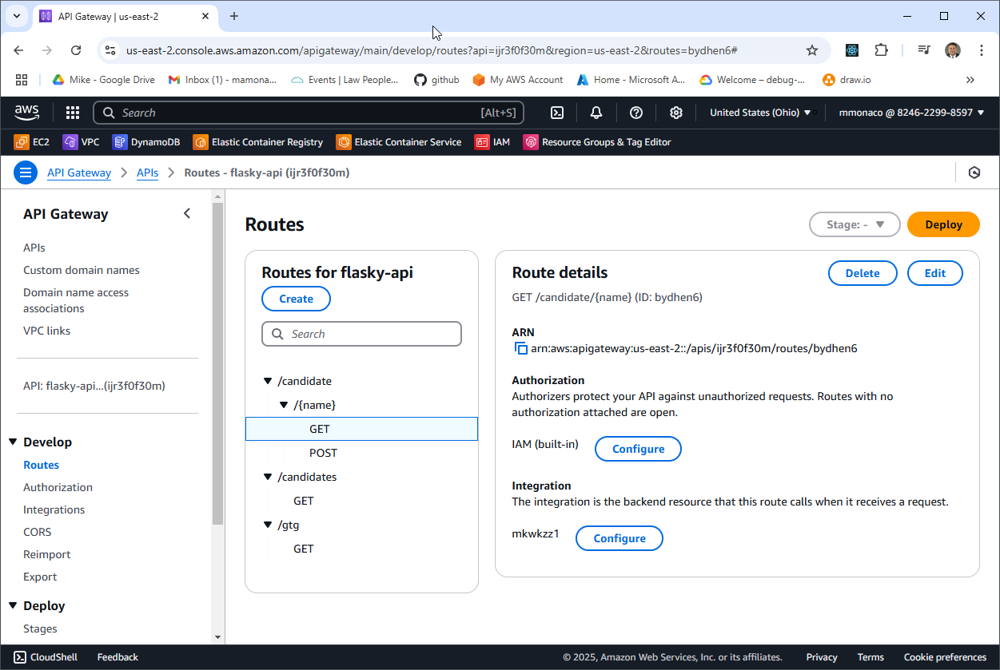
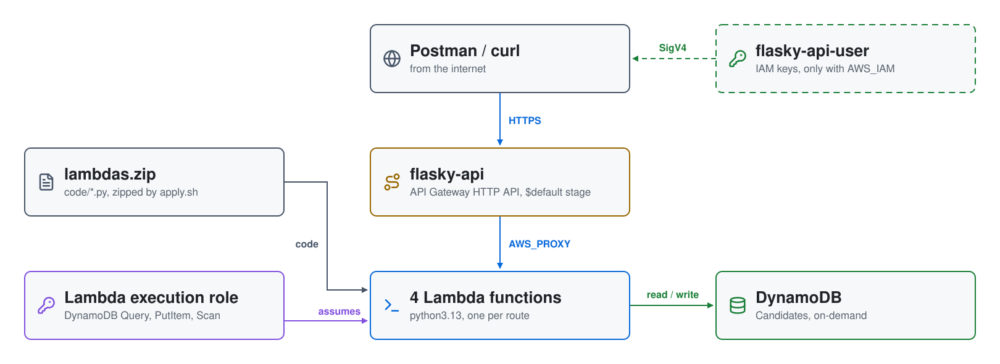
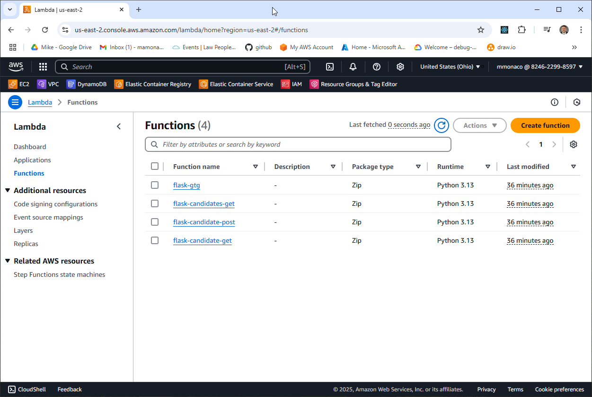
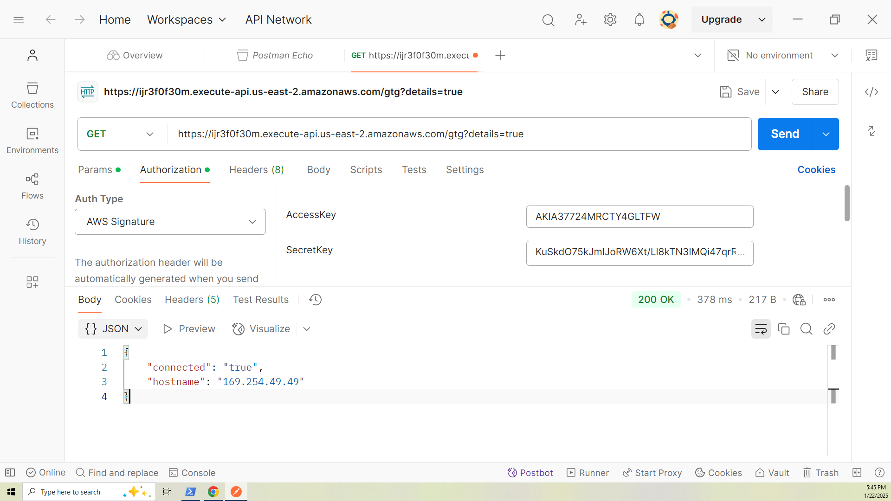

# Serverless Flask-Style API on AWS: API Gateway + Lambda

The candidate microservice from the
[AWS Auto Scaling](https://youtu.be/aBMM6vjC8d0) project, rebuilt without
servers: an **API Gateway HTTP API** routes each endpoint to its own
**Lambda** function, and the functions store candidates in **DynamoDB**. An
optional switch puts the routes behind **IAM authentication**.



| Piece | Where | Role |
|---|---|---|
| **flasky-api** | API Gateway, us-east-2 | HTTP API with an auto-deployed `$default` stage; four routes, each an `AWS_PROXY` integration |
| **Lambda functions** | us-east-2 | `flask-gtg`, `flask-candidate-get`, `flask-candidate-post`, `flask-candidates-get`, Python 3.13, from `code/lambdas.zip` |
| **Lambda execution role** | global | DynamoDB `Query`, `PutItem`, `Scan` on the table |
| **DynamoDB** | us-east-2 | `Candidates` table, keyed on `CandidateName` |
| **flasky-api-user** | IAM | only when `authorization_type = "AWS_IAM"`: an access key limited to `execute-api:Invoke` on this API |

## Architecture

<picture>
  <source media="(prefers-color-scheme: dark)" srcset="architecture-dark.svg">
  
</picture>

Regenerate with `python3 make_diagram.py`.

**`01-lambdas/`** is the whole stack: `api.tf` (API, stage, routes,
integrations, invoke permissions), `lambdas.tf`, `roles.tf`, `dynamo.tf`,
`iam.tf` (the optional API user and its key), the function code in `code/`,
and the `test_candidates` smoke tests.



## API

| Method | Path | Function | Returns |
|---|---|---|---|
| GET | `/gtg` | `flask-gtg` | 200; with `?details=true`, connection details |
| GET | `/candidate/{name}` | `flask-candidate-get` | the candidate, or 404 |
| POST | `/candidate/{name}` | `flask-candidate-post` | `{"CandidateName": <name>}`, or 500 |
| GET | `/candidates` | `flask-candidates-get` | every candidate, or 404 |

## Prerequisites

* [An AWS Account](https://aws.amazon.com/console/)
* [Install AWS CLI](https://docs.aws.amazon.com/cli/latest/userguide/getting-started-install.html)
* [Install Terraform](https://developer.hashicorp.com/terraform/install)
* `zip`
* [Postman](https://www.postman.com/downloads/) for testing

If this is your first time watching our content, we recommend starting with
this video: [AWS + Terraform: Easy Setup](https://youtu.be/BCMQo0CB9wk).

## Deploy

```bash
git clone https://github.com/mamonaco1973/aws-flasky-lambdas.git
cd aws-flasky-lambdas
./apply.sh       # or .\apply.ps1: zips code/*.py, then applies 01-lambdas
```

Everything deploys to `us-east-2`. `apply.sh` ends by running
`validate.sh`, which runs the smoke test against the API:

```
NOTE: Testing the API Gateway Solution.
NOTE: URL for API Solution is https://abc123xyz.execute-api.us-east-2.amazonaws.com/gtg?details=true
✓ good to go passed
✓ insert passed
✓ verification passed
✓ candidate list passed
```

## Try it

1. Call the endpoints with Postman or `curl`, for example
   `curl https://<api-id>.execute-api.us-east-2.amazonaws.com/candidates`.

2. Lock the routes down with IAM. In `01-lambdas/variables.tf`, set
   `authorization_type` to `"AWS_IAM"` (the default is `"NONE"`) and run
   `./apply.sh` again. `validate.sh` now fails every check with
   `Forbidden`. Get the API user's key:

   ```bash
   cd 01-lambdas
   terraform output -json     # access_key_id and secret_access_key
   ```

   In Postman, choose **AWS Signature** on the **Authorization** tab, enter
   that key, region `us-east-2` and service `execute-api`: the requests
   succeed again.

   

## Teardown

```bash
./destroy.sh     # or .\destroy.ps1
```

## Notes

- **Lab only.** With the default `authorization_type = "NONE"`, anyone can
  call the API.
